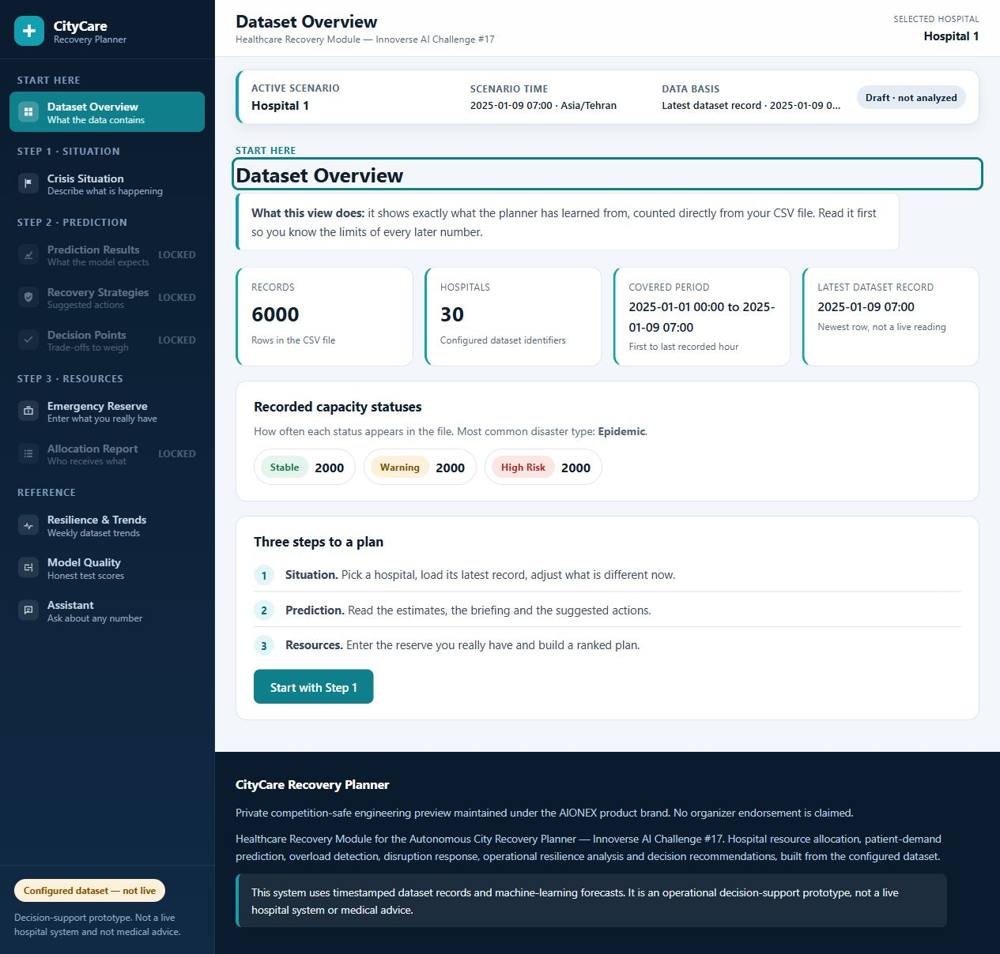
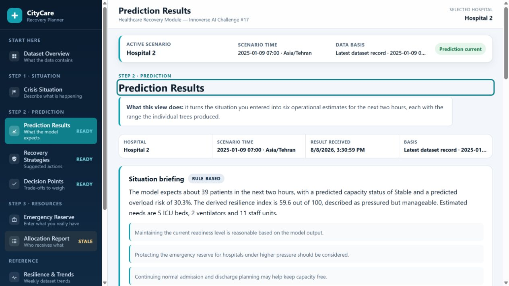
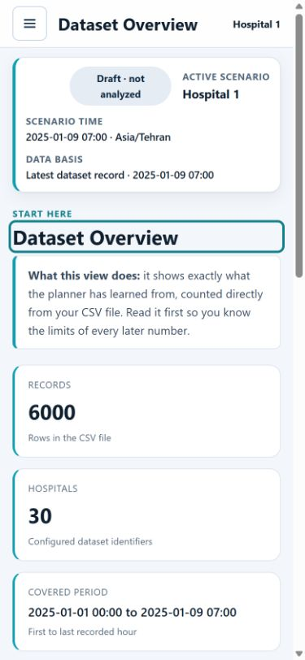
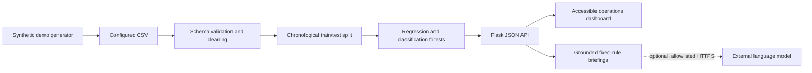

# CityCare Recovery Planner

> Private competition-safe engineering preview maintained under the AIONEX product brand.

CityCare Recovery Planner is a local-first Flask decision-support prototype for exploring hospital disruption scenarios. It combines chronological machine-learning evaluation, two-hour resource-demand estimates, transparent reserve allocation, weekly dataset trends, and grounded operational briefings in one responsive interface.

This repository is **not publicly licensed**, **not a live hospital system**, **not medical advice**, and **not cleared for public release**. It is associated descriptively with the Healthcare Recovery Module of Innoverse AI Challenge #17; no organizer endorsement, award, placement, or exclusive ownership is claimed.

## Product preview



| Scenario planning | Responsive operation |
| --- | --- |
|  |  |

The screenshots use the repository-generated synthetic demo dataset. They do not represent real hospitals, patients, incidents, or outcomes.

## What it does

- Loads a configured CSV through a strict 21-column schema and rejects unusable target rows.
- Splits records chronologically so the test period is later than the training period.
- Trains tree-based regression and classification models for structured scenario data.
- Estimates two-hour patient demand, ICU beds, ventilators, staff, overload risk, and capacity state.
- Builds a transparent, reserve-constrained allocation ranking across configured hospitals.
- Shows weekly dataset trends without presenting them as unsupported long-range forecasts.
- Provides fixed-rule explanations by default; optional language-model wording is explicitly gated.
- Keeps stale predictions and allocation reports visibly invalid after scenario changes.

## Quick start

Prerequisites: Python 3.11 or newer. The release checks were run with Python 3.14.6.

```powershell
python -m venv .venv
.\.venv\Scripts\Activate.ps1
python -m pip install --upgrade pip
python -m pip install -r requirements.lock
python scripts\generate_citycare_demo_data.py
Copy-Item .env.example .env
python app.py
```

On macOS or Linux, activate with `source .venv/bin/activate`, run the generator with forward-slash paths, and use `cp .env.example .env`.

Open `http://127.0.0.1:5000`. The safe defaults bind only to loopback and keep external AI disabled.

For development checks:

```powershell
python -m pip install -r requirements-dev.txt
python -m pytest -q
python -m ruff check app.py scripts tests
python -m bandit -q -r app.py scripts
node --check static\script.js
```

See [installation details](docs/INSTALLATION.md) and [troubleshooting](docs/TROUBLESHOOTING.md).

## Safe demo data

The tracked generator creates 6,000 deterministic synthetic rows by default:

```powershell
python scripts\generate_citycare_demo_data.py --help
python scripts\generate_citycare_demo_data.py --rows 6000 --seed 42
```

The generated CSV and the supplied challenge CSV are intentionally ignored by Git. The supplied dataset's provenance and redistribution permission have not been established. See the [data policy](docs/DATA_POLICY.md).

## System shape



The application trains models once at process startup. Model outputs remain decision-support estimates, not verified capacity, clinical guidance, or proof of operational efficacy. Read the [architecture](docs/ARCHITECTURE.md), [technical deep dive](docs/TECHNICAL_DEEP_DIVE.md), and [security model](docs/SECURITY_MODEL.md).

## Security posture

- Secrets are read from a local ignored `.env` file, with operating-system variables taking precedence.
- JSON bodies are capped at 128 KiB and validated for type, range, finiteness, and nested shape.
- Browser responses include a same-origin Content Security Policy, clickjacking protection, MIME protection, restrictive permissions policy, and no-store API caching.
- Chart.js 4.4.1 is self-hosted; the upstream MIT notice is preserved.
- Optional AI egress requires an allowlisted HTTPS host (or loopback), refuses redirects, limits response size, and never exposes the configured key to the browser.

Authentication, authorization, rate limiting, audit logging, PHI redaction, high availability, and a production WSGI deployment are not included. Do not bind this prototype publicly or enable paid AI access without adding those controls. See [SECURITY.md](SECURITY.md).

## Verified release checks

The current release candidate has passed:

- 79 Python tests, including API contracts, malformed inputs, allocation invariants, AI egress controls, and deterministic demo generation.
- Ruff lint, Bandit static security analysis, `pip check`, JavaScript syntax validation, HTML/CSS structural checks, and Git whitespace validation.
- A complete pinned runtime dependency review with no known vulnerabilities returned by the OSV advisory service on 2026-08-08.
- Desktop and mobile browser journeys using generated synthetic data.
- A final mobile Lighthouse report scoring 90 performance, 100 accessibility, 100 best practices, and 100 SEO.

These checks support reproducibility; they do not make the prototype production-ready or clinically validated.

## Repository map

| Path | Purpose |
| --- | --- |
| `app.py` | Data pipeline, models, allocation logic, grounded assistant, Flask API |
| `templates/index.html` | Semantic single-page dashboard structure |
| `static/script.js` | Workflow state, rendering, request coordination, accessibility behavior |
| `static/style.css` | Responsive design system and component styling |
| `scripts/generate_citycare_demo_data.py` | Independent deterministic synthetic dataset generator |
| `tests/` | Security, regression, contract, and generator tests |
| `docs/` | Architecture, decisions, safety, rights, and operating guidance |

## Project boundaries

- Capacity and resource outputs are model estimates over the configured data schema.
- Transfer feasibility requires verified clinical, transport, capacity, and local operational information that is absent here.
- Dataset provenance must be established independently for any non-demo data.
- Optional AI only rewrites grounded facts; its wording still requires human review.
- Model training at import/startup can duplicate CPU and memory across multiple workers.

## Competition, ownership, and license status

The interface identifies an Innoverse AI Challenge #17 origin. As of 2026-08-08, the available official 2026 materials established the event schedule but did not establish the exact #17 publication license, dataset redistribution rights, team ownership, or permission to publish before judging. The official site listed judging for August 15–22 and awards for August 24, 2026.

Accordingly:

- this repository must remain private;
- no project-level open-source license is granted;
- the supplied CSV must not be committed, uploaded, or redistributed;
- no exclusive AIONEX ownership claim is made; and
- public announcements must wait for written clearance.

Read [the publication gate](docs/PUBLICATION_GATE.md), [license decision](docs/LICENSE_DECISION.md), and [notices](NOTICE.md). Contributions cannot be accepted until contributor authority and licensing are resolved.

## Maintainer

Maintained as a private engineering preview under the **AIONEX** product brand. AIONEX is not represented here as a verified legal entity or exclusive copyright owner.
