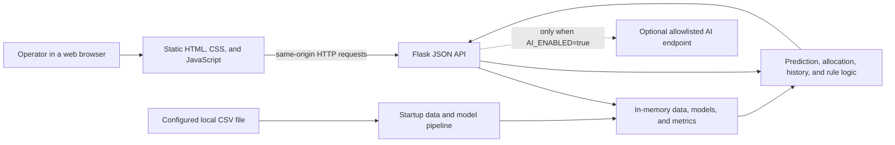

# Architecture

## Scope

CityCare Recovery Planner is a single-process Flask decision-support prototype. It loads a configured CSV file, trains two scikit-learn models during process startup, and serves a single-page dashboard plus JSON APIs. The default repository workflow uses independently generated synthetic demonstration data.

The application is not a live hospital integration, a medical device, or a production deployment reference. It has no authentication, authorization, database, message broker, or background worker.

## System context

The browser and Flask server are one application trust domain in the intended local setup. Enabling the language-model helper creates a separate network trust boundary; see [Security Model](SECURITY_MODEL.md#optional-ai-egress).

## Runtime lifecycle

1. `app.py` reads configuration from operating-system environment variables, falling back to `.env` values and then safe defaults.
2. `run_startup_self_check()` invokes the startup pipeline once when the module is imported.
3. The pipeline reads the configured CSV, verifies the 21-column contract, and retains only those required columns.
4. It cleans values, derives calendar fields, creates a chronological train/test split, and imputes missing numeric inputs with training-only medians.
5. It one-hot encodes categorical fields, trains one multi-output regressor and one classifier, and calculates held-out metrics.
6. Cleaned records, split metadata, models, metrics, feature ranges, and the latest row for each hospital remain in process memory.
7. If startup succeeds, `/api/status` reports `ready: true`. If it fails, the process still serves a sanitized `503` status response without returning the internal exception or dataset path.

Models are neither loaded from nor saved to an artifact store. Restarting the process retrains them from the configured CSV.

## Components

| Component | Implementation | Responsibility |
| --- | --- | --- |
| Web shell | `templates/index.html` | Defines ten dashboard views, forms, accessible tables, notices, and navigation. |
| Browser controller | `static/script.js` | Bootstraps status/options, manages workflow state, calls APIs, rejects stale request results, renders text safely, and drives charts. |
| Presentation layer | `static/style.css` | Responsive layout, status treatments, form states, focus styles, and reduced-motion behavior. |
| Chart renderer | `static/vendor/chart.umd.js` | Self-hosted Chart.js 4.4.1 bundle; tables remain available as a non-canvas representation. |
| HTTP application | `app.py` | Configuration, startup, validation, modeling, rules, allocation, AI adapter, and Flask routes. |
| Demo-data generator | `scripts/generate_citycare_demo_data.py` | Creates deterministic synthetic scenarios without reading or transforming another dataset. |
| Verification | `tests/` | Exercises generator guarantees, API contracts, leakage controls, allocation invariants, validation, headers, failure behavior, and AI endpoint controls. |

## Data and model pipeline

The required schema contains:

- ten numeric current-condition inputs;
- four categorical inputs, including `hospital_id` as an identifier;
- one timestamp, from which five calendar features are derived;
- five continuous target columns; and
- one capacity-status target.

The feature matrix is intentionally built from input and derived-time columns only. Output columns are excluded. The split uses the earliest 80% of unique timestamps for training and later timestamps for testing, keeping any one timestamp wholly on one side of the boundary.

For algorithm details and limitations, see [Technical Deep Dive](TECHNICAL_DEEP_DIVE.md).

## API surface

| Method and path | Purpose | Principal responses |
| --- | --- | --- |
| `GET /` | Serve the dashboard. | HTML, or the same shell with `404` for an unknown non-API path. |
| `GET /api/status` | Read readiness, dataset summary, split details, held-out metrics, feature importance, and AI mode. | `200` ready; `503` not ready. |
| `GET /api/options` | Read hospital/category options and training ranges. | `200`; `503` not ready. |
| `GET /api/hospital/<id>/latest` | Read the latest configured record for one hospital. | `200`; `404` unknown hospital; `503` not ready. |
| `GET /api/history/<id>` | Read up to 12 weekly aggregate points and simple trend directions. | `200`; `404`; `503`. |
| `POST /api/predict` | Validate a snapshot, predict two-hour targets/status, and derive supporting explanations. | `200`; `400` invalid input; `404`; `413`; sanitized `500`; `503`. |
| `POST /api/allocate` | Rank configured hospitals and distribute the operator-entered reserve. | `200`; `400`; `404`; `413`; sanitized `500`; `503`. |
| `POST /api/chat` | Answer a bounded question using fixed rules, optionally reworded by the configured AI endpoint. | `200`; `400`; `404`; `413`; sanitized `500`; `503`. |
| `POST /api/briefing` | Recalculate a snapshot and return a fixed-rule or optionally AI-worded briefing. | `200`; `400`; `404`; `413`; sanitized `500`; `503`. |

The API is an internal browser contract rather than a versioned public API. Its JSON shapes are covered by tests but do not currently have compatibility versioning.

## Browser state and consistency

The browser keeps results in an in-memory `appState` object. It does not use cookies, `localStorage`, or `sessionStorage`.

Prediction-dependent views remain locked until an analysis succeeds. Allocation-dependent views remain locked until an allocation succeeds. Editing a scenario marks an existing prediction stale; editing reserve values, objective weights, or an included scenario marks an allocation stale. Stale allocation downloads are disabled.

Request channels use `AbortController` where available and monotonically increasing request identifiers. A superseded response is ignored even if network cancellation is unavailable.

## Persistence and observability

- Source CSV data is read from local storage and retained in process memory after cleaning.
- Models, browser workflow state, chat messages, and results are not persisted by the application.
- Allocation CSV downloads are created in the browser and saved only when the operator chooses to download them.
- Server diagnostics are minimal sanitized console events. There is no durable audit log, tracing system, or metrics exporter.

## Deployment boundary

The supported default is `HOST=127.0.0.1` with Flask debug mode off. `HOST` can be changed, and debug is forcibly disabled for a non-loopback bind, but that does not make a public bind safe. Every route is unauthenticated, the built-in Flask server does not supply a production TLS/reverse-proxy boundary, and the APIs expose configured dataset summaries and model outputs to any client that can reach the port.

Before any shared-network deployment, add an authenticated gateway, authorization policy, TLS termination, rate limits, production WSGI serving, structured audit controls, and a data-governance review. The current repository should not be exposed directly to the internet.

## Related documentation

- [Technical Deep Dive](TECHNICAL_DEEP_DIVE.md)
- [User Flows](USER_FLOWS.md)
- [Security Model](SECURITY_MODEL.md)
- [Architecture decisions](DECISIONS/README.md)
