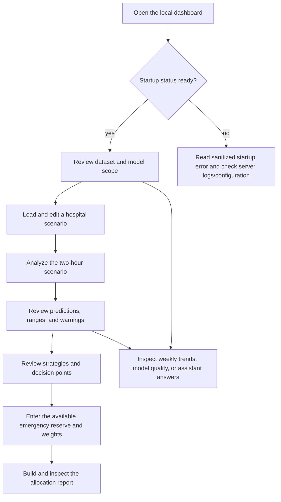

# User Flows

## Before using the planner

Use the repository-generated demo CSV for demonstrations unless a separately governed dataset is explicitly authorized. The generated rows are synthetic and do not represent real hospitals, patients, incidents, or health systems.

Keep `AI_ENABLED=false` unless an approved external-data transfer has been reviewed. The application is intended to run on loopback by default and has no user accounts or access control.

## Workflow map

## 1. Startup and orientation

1. Open the loopback URL printed by `python app.py`.
2. Wait for the status banner to finish loading.
3. Review Dataset Overview: row count, hospital count, configured period, status distribution, and latest timestamp.
4. Read the scope notes: timestamped CSV records are not a live feed, the prediction horizon is two hours, and outputs require qualified review.
5. Optionally open Model Quality to inspect the chronological split, test metrics, confusion matrix, feature importances, and model limitations.

The browser calls `/api/status`, then `/api/options`, then loads the first hospital's latest record. Controls remain disabled until all required bootstrap calls succeed. History loads afterward and a history failure does not erase an otherwise ready scenario.

## 2. Build a crisis scenario

1. Open Crisis Situation.
2. Select a configured hospital. The planner loads its latest configured dataset record.
3. Confirm or edit the timestamp, scenario categories, demand indicators, occupancy rates, equipment use, staffing ratio, and doctors available.
4. Select **Analyze Crisis and Build Recovery Plan**.
5. Correct any field-specific validation errors. The first invalid field receives focus.

The server accepts values outside the observed training range but returns a warning. Negative values, non-finite values, invalid categories, unknown hospitals, rates above 1, and timezone-offset timestamps are rejected.

Selecting another hospital or manually reloading a latest record replaces the scenario fields. Editing any field after analysis marks the prior prediction stale and cancels a pending prediction/briefing request.

## 3. Interpret a prediction

After a successful analysis, Prediction Results unlocks and displays:

- expected patients over the next two hours;
- estimated ICU beds, ventilators, and staff units;
- predicted overload risk and capacity status;
- 10th-to-90th percentile dispersion across regression trees;
- classifier probability for the selected status;
- the derived resilience index;
- training-range warnings;
- pressure-factor comparisons with training medians;
- summaries of nearby configured records; and
- fixed-rule or optionally AI-worded briefing text.

Treat the range as inter-tree model dispersion, not a calibrated probability interval. The resilience index is a project heuristic. Similar-record summaries are comparisons with CSV rows, not forecasts or transfer confirmations.

If the scenario changes, the result remains visible for comparison but is labeled stale. Re-run the analysis before relying on downstream views.

## 4. Review recovery strategies and decision points

Recovery Strategies groups rule-generated text into immediate priorities, preparation for the next two hours, monitoring priorities, and coordination options.

Decision Points explains reserve prioritization, escalation triggers, staffing-unit caveats, similar-record comparisons, resilience, and the need for qualified validation. Possible coordination hospitals have lower modeled pressure on the coded comparison criteria only. The planner does not verify capacity, transport, clinical suitability, or local policies.

These screens provide operational prompts; they do not provide diagnosis or treatment instructions.

## 5. Allocate an entered emergency reserve

1. Open Emergency Reserve.
2. Enter available whole units for ICU beds, ventilators, and staff. These values describe only the reserve being considered, not total hospital inventory.
3. Adjust the four priority weights: patient safety, overload relief, patient demand, and incident proximity.
4. Choose whether the selected hospital should use the current Step 1 scenario or its latest configured dataset row.
5. Select **Build Allocation Plan**.
6. Review totals, remaining reserve, warnings, ranking, per-hospital allocation, source row, and method details.
7. Expand beyond the first ten hospitals when needed.
8. Download CSV only after confirming the report is current.

The server normalizes weights, predicts all configured hospitals, ranks them, and allocates each resource independently. It never allocates more than the entered reserve or more than a hospital's rounded-up estimated need.

Changing reserve values, weights, scenario inclusion, or an included scenario marks the current report stale. The download button is disabled until the report is rebuilt.

## 6. Inspect resilience and weekly trends

Open Resilience & Trends to view up to 12 weekly averages for the selected hospital. The panel reports overload, bed occupancy, ICU occupancy, equipment usage, and resource-target series from the configured dataset. Direction labels come from a simple linear slope with a fixed threshold.

Selecting a different hospital loads its history. These are descriptive dataset trends, not live measurements or long-range forecasts.

## 7. Ask the assistant

The assistant supports bounded questions about the configured dataset, hospital records, predictions, history, model scores, resilience, overload, allocation, coordination, and limitations.

There are three visible modes:

- **Rule-based:** default; no language-model request is made.
- **Assisted wording:** an external model may reword the fixed answer from supplied facts.
- **Fixed-rule fallback:** AI was enabled but configuration, connectivity, or response validation failed.

Questions are limited to 400 characters. When assisted wording is enabled, the question and related operational/model context leave the application process. Do not enter personal, patient, confidential, or regulated data.

## 8. Navigate with keyboard or a small screen

- Navigation updates the URL hash and moves focus to the active view heading.
- Prediction and allocation views announce whether they are locked, ready, or stale.
- On compact layouts, the menu opens as a focus-contained drawer; `Escape` closes it and returns focus to the opener.
- Form errors use `aria-invalid` and `aria-describedby`.
- Status, stale, and loading changes use live regions.
- Charts have adjacent data tables. If Chart.js is unavailable, the values remain readable.
- Reduced-motion preferences disable smooth scrolling and animation-heavy behavior.

## Failure and recovery paths

| Condition | Visible behavior | Operator response |
| --- | --- | --- |
| Dataset/model startup failure | Status remains unavailable and APIs return `503` with a generic message. | Check local server events, `.env`, path, schema, and file access. |
| Invalid form or allocation input | Inline error plus a `400` API response. | Correct the named field and retry. |
| Unknown hospital | `404` response. | Select an identifier returned by `/api/options`. |
| Oversized JSON body | JSON `413` response. | Reduce the request; do not send file contents through these APIs. |
| Superseded request | Old response is ignored; current request continues. | Wait for the newest action to finish. |
| AI endpoint unavailable/invalid | Fixed-rule answer or briefing remains and explains that AI was not used. | Keep the fallback or correct approved configuration. |
| Chart bundle unavailable | A notice appears and the adjacent table remains usable. | Use the table; restore the local vendor asset before the next run. |

## Data handling reminder

The browser does not persist forms or chat in local storage, but visible information can still be copied, downloaded, captured, or observed by anyone with access to the browser or server. A public or shared-network bind is unauthenticated and unsupported without additional controls.
